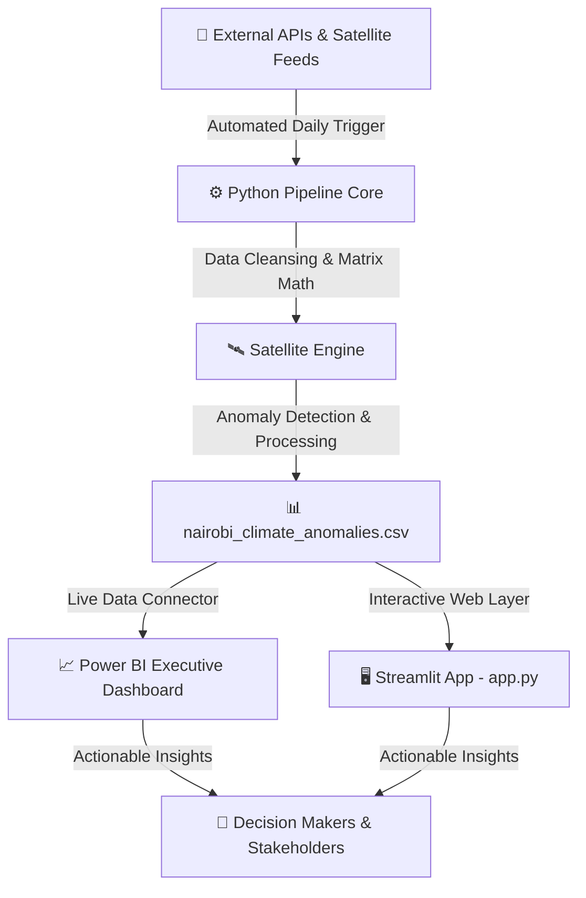
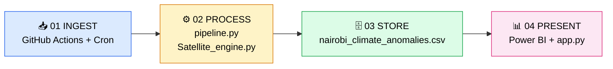
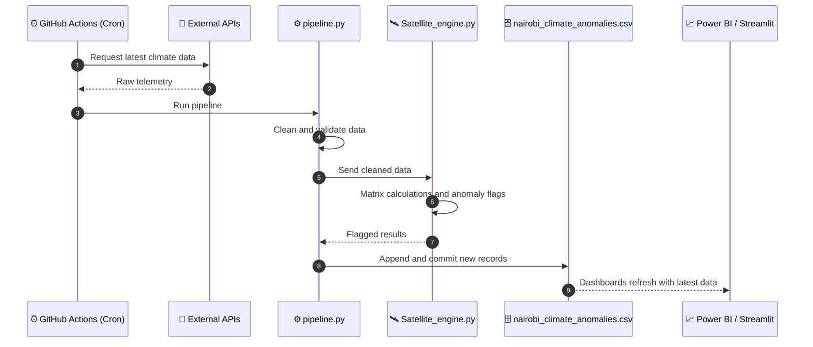
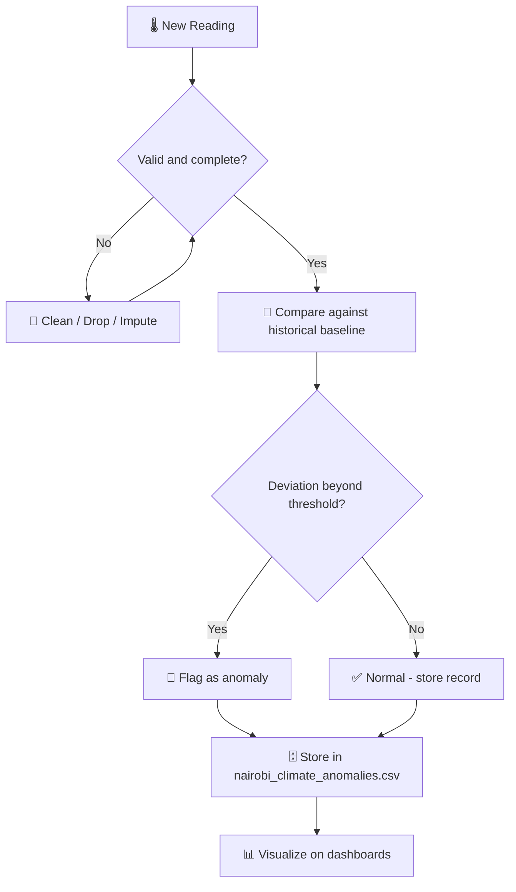
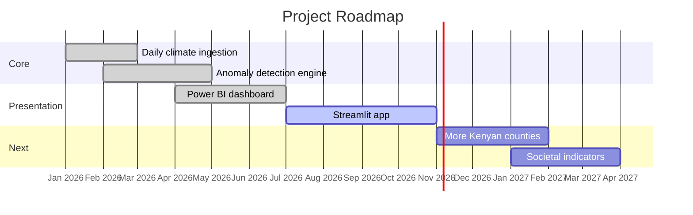

# 🌍 KENYA LIVE DATA ENGINE 🇰🇪

> An automated, real-time data science pipeline designed to track, analyze, and visualize climate and societal anomalies across Kenya. Bridging robust data engineering with executive-level interactive intelligence.

[](https://github.com/Haldline777/KENYA-_-LIVE_DATA_ENGINE/actions)
[](https://www.python.org/)
[](https://powerbi.microsoft.com/)
[](https://streamlit.io/)
[]()

---

## 📌 Table of Contents

1. [Project Overview](#-project-overview)
2. [System Data Flow Architecture](#-system-data-flow-architecture-how-data-moves)
3. [Step-by-Step Data Pipeline Lifecycle](#-step-by-step-data-pipeline-lifecycle)
4. [Daily Automation Timeline](#-daily-automation-timeline)
5. [Anomaly Detection Logic](#-anomaly-detection-logic)
6. [Repository Structure](#-repository-structure)
7. [Quick Start](#-quick-start)
8. [Roadmap](#-roadmap)

---

## 🎯 Project Overview

The **Kenya Live Data Engine** automatically collects climate and atmospheric data, cleans it, detects anomalies, and publishes the results to dashboards that decision makers can open any day without touching code.

| Question | Answer |
|---|---|
| **What does it track?** | Climate, temperature and atmospheric anomalies, starting with Nairobi |
| **How often does it update?** | Automatically, every day (GitHub Actions cron) |
| **Who is it for?** | Analysts, policy teams, researchers and executives |
| **What do I get?** | A clean anomaly dataset, a Power BI dashboard and a Streamlit app |

---

## 🤖 System Data Flow Architecture (How Data Moves)



---

## 🎯 Step-by-Step Data Pipeline Lifecycle

| Stage | Action / Flow Indicator | Core Module / File | Description & Technical Impact |
|:---:|:---|:---|:---|
| **01** | 📥 **INGEST** | GitHub Actions & Cron Workflows | Programmatically fetches raw real-time climate, temperature, and atmospheric streams autonomously. |
| **02** | ⚙️ **PROCESS** | `pipeline.py` & `Satellite_engine.py` | Cleans raw telemetry, runs complex matrix calculations, and flags environmental anomalies in real-time. |
| **03** | 🗄️ **STORE** | `nairobi_climate_anomalies.csv` | Acts as the structured local database snapshot holding historical and live anomaly records. |
| **04** | 📊 **PRESENT** | Power BI & `app.py` (Streamlit) | Serves executive-level dashboards and an interactive web app so stakeholders can explore the insights. |

### 🔄 Lifecycle at a Glance



---

## ⏱️ Daily Automation Timeline

What happens each day without anyone pressing a button:



---

## 🛰️ Anomaly Detection Logic

How a raw reading becomes an actionable alert:



> 💡 **Customize:** replace "historical baseline" and "threshold" with the exact method used in `Satellite_engine.py` (for example z-score, rolling mean, or percentile).

---

## 📂 Repository Structure

```text
KENYA-_-LIVE_DATA_ENGINE/
├── .github/
│   └── workflows/
│       └── main.yml                  # ⏰ Daily automated ingestion trigger
├── pipeline.py                       # ⚙️ Core pipeline orchestration and cleaning
├── Satellite_engine.py               # 🛰️ Matrix math and anomaly detection
├── app.py                            # 🖥️ Streamlit interactive app
├── nairobi_climate_anomalies.csv     # 🗄️ Historical and live anomaly records
├── requirements.txt                  # 📦 Python dependencies
└── README.md                         # 📖 You are here
```

---

## 🚀 Quick Start

```bash
# 1. Clone the repository
git clone https://github.com/Haldline777/KENYA-_-LIVE_DATA_ENGINE.git
cd KENYA-_-LIVE_DATA_ENGINE

# 2. Install dependencies
pip install -r requirements.txt

# 3. Run the pipeline manually
python pipeline.py

# 4. Launch the interactive app
streamlit run app.py
```

**Power BI:** open Power BI Desktop, choose **Get Data → Web/Text**, and point it to the raw URL of `nairobi_climate_anomalies.csv` on GitHub for live sync.

---

## 🗺️ Roadmap



> 💡 **Customize:** adjust the dates and statuses in the Gantt chart to match your real progress.

---

## 👤 Author

**Haldline777** · Data Science and Data Engineering · Nairobi, Kenya 🇰🇪

⭐ If you find this project useful, please star the repository!